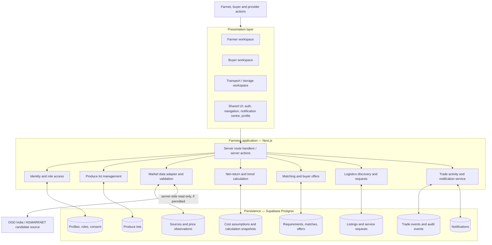
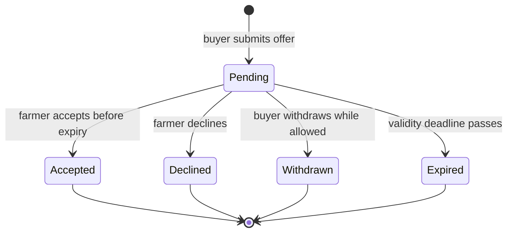
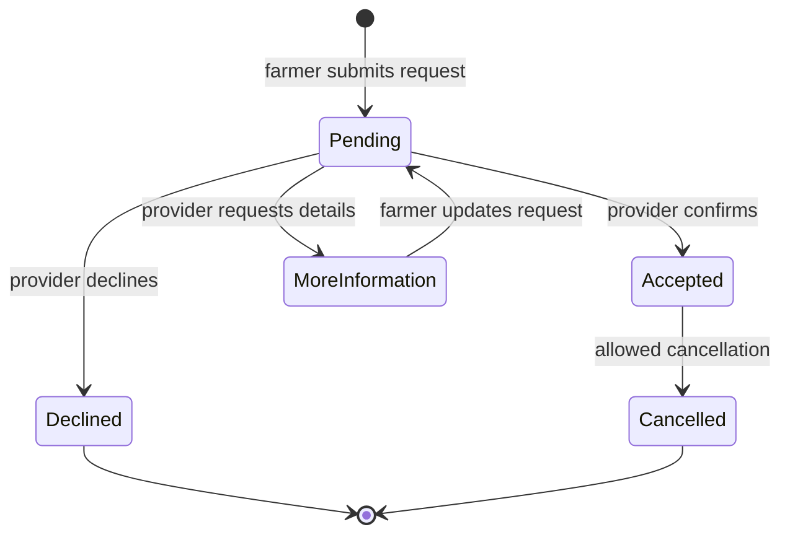

# FARMESS — Product, Technical Architecture & Six-Member Build Playbook

**Team:** CodeFarm · Team 13  
**Event:** ANANTA 2026 — SANGAM × DevGrowth × Code Club, SMVDU  
**Product:** Farmess *(working name; confirm spelling and brand clearance before public launch)*  
**Tagline:** Know the market. Understand the costs. Decide with confidence.  
**Document type:** Source of truth for product scope, implementation, GitHub collaboration and AI-assisted development  
**Prepared:** 22 November 2026  
**Status:** Build specification. This document describes the product the team intends to build; it is not proof that any feature, integration, test, deployment or business outcome already exists.

---

## How the team must use this file

This file is the shared contract for all six developers and all GPT sessions. Put it at the **root of the GitHub repository** as `ARCHITECTURE.md`. Every teammate should attach or open this same file in their own GPT session and then paste only their own role-specific prompt from **Section 20**.

The role prompts create a starting area of responsibility, **not six isolated silos**. Every member must understand the full product and make meaningful contributions across frontend, backend/data, testing and documentation. To prevent six AI sessions from overwriting one another, the team must still coordinate through GitHub Issues, branches and pull requests. Do not ask six agents to independently scaffold or rewrite the entire application.

### Source-of-truth order

When instructions conflict, use this order:

1. This `ARCHITECTURE.md` for approved product and implementation rules.
2. The supplied `CodeFarm_Farmess_Round2_UX_Documentation(2).docx` for the Round 2 scope, flows, rubric and design specifications.
3. The current Farmess Figma source for the visual appearance and interactions of frames that actually exist: [CodeFarm — Farmess Round 2 Figma](https://www.figma.com/design/S0JzUA0lpaApwy8ifPeCZn/CodeFarm---Farmess-%7C-Round-2-UX-Design---Prototype?node-id=0-1).
4. Approved GitHub Issues, pull requests and decisions added by the team after this document.

**Do not pretend that a Figma screen exists if it does not.** Inspect the live Figma file before implementing a screen whose layout is shown there. For routes that are required by the supplied sitemap but do not yet have a Figma frame, follow the design tokens and existing screen conventions in this document, identify the screen as a documented extension, and get the UI owner to review it. If a GPT session cannot access Figma, ask a teammate to export the relevant frame screenshots or provide a screen recording. Do not invent a different dashboard style.

### Project facts to fill in once

| Item | Team value |
|---|---|
| GitHub repository | **Add the actual repository URL here** |
| Default branch | `main` unless the repository already uses another protected default |
| Figma file | [Open Farmess Figma](https://www.figma.com/design/S0JzUA0lpaApwy8ifPeCZn/CodeFarm---Farmess-%7C-Round-2-UX-Design---Prototype?node-id=0-1) |
| Supabase project | Create/use the team project; never paste secrets in this document or chat |
| Deployment target | Choose after checking current free-tier terms and the intended commercial use |
| Product owner / integration lead | Mayank — Team Lead |

---

# PART I — PRODUCT DEFINITION

## 1. What Farmess is

Farmess helps a farmer compare feasible selling options for a specific produce lot using dated mandi observations, actual buyer offers where available, entered or verified selling costs, and post-harvest constraints.

The primary user is a small farmer selling perishable produce. The product helps the farmer understand what they may retain after costs; it does **not** guarantee a price, profit, buyer, sale or reduction in post-harvest loss.

### The core decision question

> Given the crop, variety, grade, quantity, location and selling urgency of this produce lot, which feasible market or buyer option may provide the strongest estimated net realisation after relevant costs and expected quality loss?

### Core formula

```text
Estimated net realisation
  = expected sale value
  - transport cost
  - handling / packaging cost
  - market charges
  - storage cost
  - expected quality-loss cost
  - other explicit deductions
```

Show the result on a common unit basis, for example INR per quintal, as well as the total for the lot where appropriate. Every deduction must be visible. Every value must be identified as reported, quoted, entered, estimated, calculated or illustrative.

### Non-negotiable product principles

1. **Farmer remains in control.** Farmess provides decision support; the farmer makes the final selling decision.
2. **Net realisation matters more than headline price.** A higher mandi price or buyer quote may result in a lower estimated net return after costs.
3. **Every figure needs context.** Show source, observation date, retrieval date where relevant, unit, quantity basis and value type.
4. **No false certainty.** Unknown costs are not zero. Unavailable data is not fabricated. A provider request is not a confirmed booking. A buyer offer is not a completed sale.
5. **Explain calculations.** Users must be able to inspect the gross value, every deduction, assumptions and missing information.
6. **Privacy by default.** Exact farmer location and contact details are not exposed to buyers or providers unless the farmer consents and the workflow requires it.
7. **Build the documented product, not an imaginary AI dashboard.** Do not add fake AI recommendations, predictive claims, live data labels, ornamental badges or marketing metrics.
8. **Mobile usability is essential.** A farmer must be able to complete the main task on a 390 px mobile viewport.

## 2. Product scope and delivery priorities

The supplied UX documentation groups features into P0, P1 and P2. Keep that prioritisation when planning implementation. Do not let optional features delay the complete P0 farmer decision flow.

| Priority | Module | Required product behaviour |
|---|---|---|
| P0 | Farmer lot entry | Crop, variety, grade, quantity/unit, location, availability date and sell-by urgency; review before submission; validation and field-level errors. |
| P0 | Market price explorer | Crop/variety/market filters; reported min/max/modal values where supported; source, observation date, unit, retrieval time/freshness and history. |
| P0 | Net-return comparison | Compare feasible market options; show gross value, explicit deductions, estimated net per unit, total and assumptions. |
| P0 | Recommendation explanation | Show feasibility, why an option appears, ranking basis, freshness, uncertainty and missing-data states. No opaque ranking. |
| P0 | Trend view | Show historical observations and gaps. Prediction is unavailable unless sufficient validated data and a baseline are demonstrated. |
| P0 | Role-aware access and persistence | Sign-up/sign-in, farmer profile, role-restricted data, saved lots and persistent records. |
| P0 | In-app notifications foundation | Persistent notification records, unread counter, read/unread state, mark one read, mark all read and open related record. Deliver events as the relevant P1 workflows are implemented. |
| P1 | Buyer requirements and matching | Buyers create requirements; compatible lots can be listed; matching must be explainable and based on explicit fields. |
| P1 | Buyer offers | Buyer submits price, quantity, validity and terms; farmer reviews and accepts/declines; expired/withdrawn states are handled. |
| P1 | Transport pooling | Route, pickup date, capacity, compatible lots, indicative cost and provider confirmation. |
| P1 | Storage discovery | Location/area, crop suitability, indicative rate and availability verification state. |
| P1 | Sale activity | Record agreed terms, dispatch, weighment, delivery and payment-status evidence without pretending Farmess processes payment. |
| P1 | Role-scoped notification events | New offers, offer status changes, matching lots, logistics requests/responses, sale milestones and important account/security notices. |
| P2 | Image grading / advanced prediction | Stretch only. Do not begin unless the team has a defensible dataset, evaluation plan, confidence display and human confirmation. |

### Explicitly out of scope for the first working version

- Payment gateway, escrow, wallet, commission settlement or financial custody.
- Guaranteed buyers, verified transport availability or automatic bookings without provider confirmation.
- AI crop grading, image disease diagnosis, ML price forecasting or “best time to sell” claims.
- Public display of exact farmer GPS coordinates, phone number or private contact details.
- Scraping websites or integrating a dataset without checking its access method, terms, fields, update frequency and attribution rules.
- Complex microservices, event brokers, Kubernetes or multiple backends. A small team should first deliver a secure, understandable modular application.

---

## 3. User roles and personas

These personas are **provisional hypotheses**, not evidence of completed interviews. Update them only with anonymised, consented feedback from real participants.

### Farmer — primary user

- **Goals:** sell within a limited time; compare feasible options; understand deductions; make an informed decision.
- **Pain points:** scattered prices, unclear deductions, limited bargaining information, spoilage pressure, transport/storage uncertainty and unreliable connectivity.
- **Design needs:** simple language, mobile-first forms, visible urgency, readable numbers, transparent price provenance, recoverable errors and a clear decision path.

### Local produce buyer

- **Goals:** find crop/variety/grade/quantity that matches a requirement; make a clear offer with validity and pickup terms.
- **Pain points:** incomplete lot details, inconsistent units, uncertain availability and unclear offer status.
- **Design needs:** filterable lots, clear lot details, comparable quantities, explicit terms and a predictable offer lifecycle.

### FPO / logistics coordinator or service provider

- **Goals:** coordinate multiple lots, transport and storage options.
- **Pain points:** uncertain route/date/capacity, cost allocation, privacy and ambiguous confirmation.
- **Design needs:** route/date/capacity fields, compatible lots, indicative-versus-confirmed pricing, request handling and clear status tracking.

### Research evidence rule

For any interview or usability test, record the date, participant type, consent, anonymised notes, task outcomes and resulting design changes. Do not publish names, phone numbers or exact home/farm locations. If research has not happened, state “field validation pending”; do not manufacture quotes or participant counts.

---

## 4. Sitemap and route map

Implement role-aware routes that map to this information architecture. Route naming can be adapted to the current repository, but the information structure and labels should remain consistent.

```text
FARMESS
├── Public
│   ├── Welcome
│   ├── Sign in
│   ├── Sign up
│   ├── Password recovery
│   └── Role selection / onboarding
├── Farmer workspace
│   ├── Overview
│   ├── My Produce
│   │   ├── Create Lot
│   │   ├── Review Lot
│   │   └── Lot Details
│   ├── Market Prices
│   │   ├── Price Explorer
│   │   └── Market History
│   ├── Compare Markets
│   │   └── Net-return Breakdown
│   ├── Buyer Offers
│   │   ├── Offer Details
│   │   └── Respond to Offer
│   ├── Transport & Storage
│   │   ├── Transport Pools
│   │   ├── Storage Directory
│   │   └── Service Details / Request
│   ├── Sale Activity
│   │   └── Sale Timeline
│   └── Notifications / Profile / Privacy
├── Buyer workspace
│   ├── Overview
│   ├── Post Requirement
│   ├── Matching Lots
│   │   └── Lot Details
│   └── Offers
│       ├── Create Offer
│       └── Manage Offers
├── Transport / Storage provider workspace
│   ├── Overview
│   ├── My Listings
│   ├── Requests Received
│   ├── Request Details / Respond
│   └── Activity
└── Shared
    ├── Notifications
    ├── Profile & Preferences
    ├── Privacy / Consent
    └── Help
```

### Navigation labels

Use plain labels: `Overview`, `My Produce`, `Market Prices`, `Compare Markets`, `Buyer Offers`, `Transport & Storage`, `Sale Activity`, `Notifications` and `Profile`.

Do not create artificial breadcrumb-like labels such as “the journey”, “market intelligence”, “path routes”, “glimpses”, or folder-path headings. Do not add “AI-powered” labels unless a real, validated AI capability is later approved.

---

# PART II — FRONTEND AND FIGMA PARITY

## 5. Frontend must follow the actual prototype

**The Figma prototype is the visual reference, not a loose inspiration board.** Implement the existing screens so the website uses the same hierarchy, layout, navigation labels, field order, terminology, actions, spacing, responsive behaviour and state design. Do not replace it with a generic admin dashboard or a generic shadcn theme.

### Figma source

[Open the Farmess Figma file](https://www.figma.com/design/S0JzUA0lpaApwy8ifPeCZn/CodeFarm---Farmess-%7C-Round-2-UX-Design---Prototype?node-id=0-1)

At the last known inspection, the file contained an original page and a responsive prototype page. Known frame names included:

- Farmer dashboard / Overview
- Create a produce lot
- Market comparison
- Buyer offers and logistics
- Desktop Overview, Create Lot, Market Comparison, Buyer Offers, Transport & Storage, Sale Activity
- Mobile Overview, Create Lot, Compare Options and Buyer Offers

Frame names and IDs can change; inspect the live file before using node IDs. The earlier inspected desktop frames included IDs `2:2`, `2:46`, `2:89`, `2:139`; responsive examples included `6:3`–`6:8` and `6:337`–`6:340`. Treat these as historical lookup hints, not permanent identifiers.

### Screen parity procedure

For every Figma frame being implemented:

1. Inspect the frame at 100% and note its dimensions, page title, sidebar/header, content width, grid, spacing and typography.
2. Capture a reference screenshot for the PR. Never use the screenshot as a flattened website background; build real HTML/components.
3. Match the layout and content hierarchy, not just the colour palette.
4. Make controls real: forms validate, routes navigate, list items open details, actions show server-confirmed status.
5. Add the documented state variants: loading, empty, validation error, network error, stale data, expired, unconfirmed, success and pending.
6. Compare a browser screenshot to the Figma frame at the same viewport. Fix visible differences before requesting review.
7. Repeat for desktop, tablet and mobile. Mobile is not merely a scaled desktop view.

If the exact Figma frame is missing for a sitemap route, derive it from the documented wireframe specification and reuse the same design system. Mark it as a new implementation screen and obtain Bhavishya's visual review. Never claim it is an exact existing Figma frame.

## 6. Design system and responsive rules

These tokens come from the supplied Round 2 UX documentation and should be implemented as CSS variables/design tokens.

| Token | Value | Use |
|---|---|---|
| Brand primary | `#173D32` | Primary actions and brand anchors |
| Secondary green | `#336B52` | Secondary emphasis and selected states |
| Background | `#F7F8F5` | Warm off-white page background |
| Surface | `#FFFFFF` | Cards and forms |
| Text | `#26322D` | Main text |
| Muted text | `#63706A` | Secondary labels and descriptions |
| Accent | `#C75A38` | Warnings and urgency, not success |
| Harvest accent | `#C59A4A` | Restrained highlights only |
| Typography | Inter | English UI |
| Hindi typography | Noto Sans Devanagari | Only if Hindi UI is added |
| Spacing scale | 4 / 8 / 12 / 16 / 24 / 32 px | Consistent layout rhythm |
| Input radius | 8 px | Form controls |
| Card radius | 12–16 px | Surfaces and cards |

### Responsive reference viewports

| Viewport | Behaviour |
|---|---|
| Desktop — 1440 px | Persistent sidebar; readable content max-width; comparison cards/tables can use columns; notification entry in header. |
| Tablet — 768 px | Sidebar collapses or becomes compact; keep labels and hierarchy; cards wrap without horizontal overflow. |
| Mobile — 390 px | Single-column forms/cards; bottom navigation; comfortable touch targets; data tables become stacked summaries or carefully controlled horizontal scroll; notification access remains visible. |

### Component inventory

Create reusable components with the listed variants. Prefer components already present in the repository; do not duplicate UI libraries.

| Component | Required variants/states |
|---|---|
| Button | Primary, secondary, text, disabled, loading |
| Input / Select | Default, focused, error, disabled, helper text |
| Price card | Reported mandi observation, buyer offer, stale observation |
| Net-return card | Feasible option, alternative, insufficient data |
| Status badge | Pending, accepted, declined, expired, stale, unconfirmed |
| Offer card | Pending, accepted, declined, expired, withdrawn |
| Freshness label | Fresh observation, old/stale observation, unavailable |
| Feedback panel | Loading, empty, error, success |
| Navigation | Desktop sidebar, compact tablet nav, mobile bottom nav |
| Notification item | Unread, read, actionable, related record unavailable |
| Form field | Label, hint, input, inline error, disabled |
| Confirmation dialog | Confirm, cancel, processing, error |

### Accessibility

- Use semantic landmarks and correct heading order.
- Associate labels and error descriptions with form controls.
- Ensure keyboard focus is visible and all actions work without a mouse.
- Do not encode a status using colour alone; pair colour with text.
- Maintain readable contrast and comfortable touch targets.
- Use clear language and do not hide financial deductions in tiny text.
- Respect reduced-motion preferences; animations must not block task completion.

## 7. Screen-by-screen implementation requirements

### Shared screens

**Welcome / role / authentication**
- Farmess value proposition and role choice.
- Sign-up, sign-in, sign-out, password recovery and session handling.
- Role selection is saved server-side and validated against allowed roles.
- Show validation and authentication errors clearly.

**Notifications**
- Bell/notification entry point and unread count.
- Notification centre with title, body, event category, timestamp, read/unread and related record.
- Mark one notification read; mark all read; opening an actionable notification navigates to the linked record.
- If the related record is deleted or permission is revoked, show a safe “record unavailable” state.

**Profile / preferences / privacy**
- User name and role, editable contact preferences, location visibility and consent controls.
- Do not display phone numbers or exact coordinates on public profile views.

### Farmer screens

1. **Overview:** greeting, Add Produce Lot action, active lots, offer alerts and a recent price check. Include an honest first-use empty state.
2. **My Produce:** farmer-owned lots with crop, variety/grade, quantity/unit, sell-by date and status. Open lot detail; do not expose private data to unrelated users.
3. **Create Lot:** crop, variety, grade, quantity, unit, location/area, available date and urgency/sell-by. Validate and preserve entered values on errors.
4. **Review Lot:** show all entered values, edit links and privacy note before saving/publishing.
5. **Market Prices:** crop/variety/market filters; reported price fields where supported; market, source, observation date, retrieval time, unit and freshness state.
6. **Market Detail / History:** show historical observations with visible gaps. If there is no usable history, show that clearly; do not invent a chart.
7. **Compare Markets:** compare only compatible and feasible options; distinguish mandi observations and buyer offers; show gross value, costs and net per unit.
8. **Net-return Breakdown:** show each deduction, amount, unit basis, source/type, assumptions and missing information. Explain why an option ranks as it does, or state that comparison is incomplete.
9. **Buyer Offers:** buyer status/verification label only when evidence exists; matched lot, price, quantity, validity, terms and current offer status.
10. **Offer Details / Response:** full terms; accept/decline confirmation; expired offers cannot be accepted; server-confirmed response only.
11. **Transport & Storage:** transport pools and storage listings; route/area, date, capacity, crop suitability, indicative rate and verification state.
12. **Service Details / Request:** show whether availability is verified; submit request; remain `pending` until provider response.
13. **Sale Activity:** timeline for offer, agreed terms, dispatch, weighment, delivery and payment-status evidence. Do not claim payment has been processed by Farmess.

### Buyer screens

1. **Buyer Overview:** active requirements, matching lots, submitted offers and statuses; provide an honest empty state.
2. **Post Requirement:** crop, variety, grade, quantity/unit, preferred location/area and pickup/required date.
3. **Matching Lots:** list permitted lot summaries with explicit match reasons (crop/variety/grade/quantity/area/date). No hidden or AI scoring.
4. **Lot Details:** display only farmer-approved/allowed details; contact disclosure follows consent rules.
5. **Create Offer:** price, quantity/unit, validity deadline, pickup terms, notes and review before submission.
6. **Manage Offers:** pending, accepted, declined, expired and withdrawn states; allow buyer to withdraw only while rules permit.

### Transport / storage provider screens

1. **Provider Overview:** own active listings and requests received.
2. **Manage Listings:** service type, route/area or facility, capacity, available dates, suitability and indicative rate.
3. **Requests Received:** only requests assigned to that provider.
4. **Request Detail / Respond:** accept, decline or request more details; confirmation is explicit and recorded.
5. **Provider Activity:** status history of assigned requests; no access to unrelated farmer or buyer information.

---

# PART III — APPLICATION ARCHITECTURE

## 8. Recommended technology stack

Use a **single modular web application** first. A six-person student team does not need microservices to deliver this product.

| Area | Recommended choice | Why / implementation rule |
|---|---|---|
| Web framework | Next.js App Router | One application for pages and server-side route handlers; supports server/client component separation. |
| Language | TypeScript | Shared types across UI, server logic and database-generated models. |
| UI styling | Tailwind CSS with Farmess CSS variables | Fast responsive styling while preserving the supplied Figma tokens. Do not let a component preset override the Figma design. |
| UI components | Small local component library; use an existing accessible component only when it matches the design | Avoid generic dashboard styling and duplicate component systems. |
| Icons | One outline SVG/icon library used sparingly | Icons must have labels for critical actions; avoid unnecessary decoration. |
| Backend / database | Supabase Postgres | Relational data fits users, lots, observations, offers, requests, activity and notifications. |
| Authentication | Supabase Auth | Session-based sign-in; enforce authorization in server/database policies. |
| Supabase SSR integration | `@supabase/ssr` plus `@supabase/supabase-js` | Use cookie-based SSR session pattern from current official docs; keep this behind a small adapter because APIs can evolve. |
| Validation | Zod schemas shared by server and forms | Validate all untrusted input on the server; browser validation is only a usability aid. |
| Forms | React Hook Form + Zod resolver where forms are complex; plain controlled forms for small ones | Use consistently; do not add a second form library. |
| Charts | A lightweight accessible chart only when there is real historical data | The chart must show source dates and gaps; no fake prediction series. |
| Unit / component tests | Vitest + React Testing Library | Calculation, validation, matching and component states. |
| End-to-end tests | Playwright | Exercise real role journeys and responsive layouts. |
| Formatting / lint | ESLint + Prettier with one checked-in config | Consistent formatting and reliable CI. |
| Database change control | Supabase CLI migrations committed to Git | No untracked manual schema edits on the shared remote database. |
| Deployment | Choose after checking current plan terms and the product's commercial intent | Do not assume a free hobby tier is suitable for a commercial startup. |

### Architecture decision rules

- Do not add Express as a separate server unless the repository already has a justified backend that should be retained.
- Do not add Redux or another global state library unless a measured use case requires it. Server data belongs in server components or feature-level data functions; local UI state stays local.
- Do not add an AI SDK, vector database, payment SDK or message broker in the MVP.
- Do not build a separate microservice for market prices or notifications yet. Use a module boundary and route handlers so the code can be extracted later if needed.
- Check the current official documentation and compatible package versions before installing/upgrading. Commit one lockfile and keep it in sync with `package.json`.

## 9. Logical architecture



### Layer responsibilities

1. **Presentation:** responsive role-specific workspaces, forms, lists, comparison views, activity and notifications. The UI calls authorised application functions; it is never the security boundary.
2. **Identity and access:** session validation, profile/role lookup, consent and permission checks.
3. **Domain services:** lot management, market data retrieval/normalisation, cost calculation, matching, offer lifecycle, logistics requests, trade events and notification creation.
4. **Persistence:** relational data with foreign keys, constraints, indexes, migrations and row-level security.
5. **External sources:** market price data only through a server-side adapter after the team verifies source access and permitted use.

## 10. Repository structure

Adapt to an existing repository before creating folders. If the repo is empty, use a structure close to this. Avoid duplicate `src`, `app`, `client`, `server` roots or multiple lockfiles.

```text
farmess/
├── ARCHITECTURE.md
├── README.md
├── CONTRIBUTING.md
├── .env.example
├── .gitignore
├── .editorconfig
├── .prettierrc.json
├── .prettierignore
├── eslint.config.mjs
├── package.json
├── package-lock.json              # or one chosen package-manager lockfile only
├── next.config.ts
├── tsconfig.json
├── public/
│   ├── images/
│   └── icons/
├── src/
│   ├── app/
│   │   ├── (public)/
│   │   │   ├── page.tsx
│   │   │   ├── sign-in/page.tsx
│   │   │   ├── sign-up/page.tsx
│   │   │   └── forgot-password/page.tsx
│   │   ├── (workspace)/
│   │   │   ├── farmer/...
│   │   │   ├── buyer/...
│   │   │   └── provider/...
│   │   ├── notifications/page.tsx
│   │   ├── profile/page.tsx
│   │   ├── api/
│   │   │   ├── lots/route.ts
│   │   │   ├── market-prices/route.ts
│   │   │   ├── comparisons/route.ts
│   │   │   ├── requirements/route.ts
│   │   │   ├── offers/route.ts
│   │   │   ├── logistics/route.ts
│   │   │   └── notifications/route.ts
│   │   ├── layout.tsx
│   │   └── globals.css
│   ├── components/
│   │   ├── layout/                 # sidebar, header, mobile navigation
│   │   ├── ui/                     # buttons, inputs, tables, dialogs, status labels
│   │   ├── feedback/               # loading, empty, error and success panels
│   │   └── data-display/           # price, offer, net-return and timeline components
│   ├── features/
│   │   ├── auth/
│   │   ├── lots/
│   │   ├── markets/
│   │   ├── net-return/
│   │   ├── requirements/
│   │   ├── offers/
│   │   ├── logistics/
│   │   ├── activity/
│   │   └── notifications/
│   ├── lib/
│   │   ├── supabase/client.ts
│   │   ├── supabase/server.ts
│   │   ├── auth/                   # current user, role checks
│   │   ├── permissions/            # server-side permission helpers
│   │   ├── validators/             # Zod schemas
│   │   ├── market-data/            # provider interface, OGD adapter, normalisation
│   │   ├── calculations/           # pure net-return functions and unit conversions
│   │   ├── matching/               # deterministic matching rules
│   │   └── errors/                 # typed domain errors
│   └── types/
│       └── database.ts             # generated Supabase types; do not hand-edit generated file
├── supabase/
│   ├── config.toml
│   ├── migrations/
│   ├── seed.sql
│   └── tests/                      # RLS and database tests
├── tests/
│   ├── unit/
│   ├── integration/
│   └── e2e/
└── .github/
    ├── workflows/ci.yml
    ├── ISSUE_TEMPLATE/
    ├── pull_request_template.md
    └── CODEOWNERS
```

### Module rules

- `features/<domain>` owns domain-specific UI and client-facing feature logic.
- `lib/<domain>` owns pure/domain logic that must not depend on React components.
- `app/api` owns HTTP boundaries and request/response handling; it calls domain services rather than containing complex business rules.
- Supabase clients are created through the shared server/browser modules; do not create a new client differently in every file.
- Generated database types are regenerated from migrations/schema; do not manually edit generated output.
- Shared UI components must not contain domain-specific permission decisions.

## 11. Authentication, roles and permissions

### Authentication behaviour

- Use Supabase Auth for email/password sign-up, sign-in, sign-out and password recovery.
- Use the current cookie-based SSR integration documented for Next.js. Keep server and browser clients separate.
- After sign-up, create or complete the `profiles` record. If profile creation fails, show a recoverable state; do not leave a user in an unusable half-onboarded state.
- One account has one primary role in the MVP: `farmer`, `buyer`, or `provider`; `admin` is assigned only through a trusted administrative procedure. If the team later proves that multi-role accounts are required, migrate to a role-membership table deliberately.
- The frontend may hide links based on role, but **every server action/route and database operation must independently check authorisation**.
- Never trust a role value coming from an editable client form or user-controlled metadata.

### Permission matrix

| Capability | Farmer | Buyer | Transport / storage provider | Admin / reviewer |
|---|---|---|---|---|
| View/update own profile/preferences | Own | Own | Own | Authorised support only |
| Create/update own produce lot | Yes | No | No | Review only if an approved moderation policy exists |
| View lot details | Own lots; permitted shared fields for matched participants | Only farmer-published/consented fields | Only fields needed for an assigned service request | Authorised review only |
| Create buyer requirement | No | Yes | No | Support only if authorised |
| Create/manage buyer offer | Respond to offers on own lot | Create/manage own offers | No | Audit/support only if authorised |
| Manage logistics listing | No | No | Own listings | Moderate only if approved |
| Respond to logistics request | No | No | Own assigned requests | Audit/support only if authorised |
| View sale activity | Own sale and allowed counterpart events | Own offer/transaction events | Own assigned service milestones | Authorised audit view |
| Read notifications | Own inbox only | Own inbox only | Own inbox only | No blanket access; support only if explicitly authorised |
| View exact farmer contact/location | Own data | Only after consent and required workflow step | Only when needed and authorised | Restricted, audited access |

### Security baseline

- Enable Row Level Security on every table exposed to the client/API schema.
- For each table, explicitly define grants and separate policies for `SELECT`, `INSERT`, `UPDATE` and `DELETE` as needed. Do not assume a policy automatically removes broad table grants.
- Add positive **and negative** RLS tests: a farmer can access their own lot, another farmer cannot; a buyer can see only published/allowed lot fields; an operator can see only assigned requests; one user cannot read another user's notifications.
- Use `auth.uid()` as the authenticated identity in database policies. Do not rely on user-editable `user_metadata` for privileged role decisions.
- Keep any Supabase service-role/secret key server-only. Never prefix it with `NEXT_PUBLIC_`, never send it to the browser and never commit it.
- Keep `.env.local` out of Git. Commit `.env.example` with placeholder names only.
- Validate and authorise on the server even if the browser already validated.
- Do not return private fields in API responses and hope the UI hides them; omit them at the query/serialisation boundary.
- Rate-limit sensitive actions where practical; make mutation endpoints idempotent where duplicate submissions are possible.

---

## 12. Database model

Use UUID primary keys, `created_at`/`updated_at` timestamps, explicit foreign keys and indexes on ownership/status/lookup fields. Choose numeric/decimal types for money and quantities; do not use floating point for stored financial values.

The following is the logical model. Implement it with versioned migrations and refine field types/constraints in code review.

| Table | Core fields | Relationships / notes |
|---|---|---|
| `profiles` | `id` (FK to auth user), `display_name`, `role`, `phone_private`, `district`, `state`, `contact_preferences`, `created_at`, `updated_at` | One primary role in MVP. Contact data is private. |
| `consent_records` | `id`, `user_id`, `consent_type`, `status`, `scope`, `recorded_at`, `revoked_at` | Record location/contact disclosure consent. |
| `produce_lots` | `id`, `farmer_id`, `crop`, `variety`, `grade`, `quantity`, `unit`, `location_area`, `available_at`, `sell_by`, `status`, timestamps | Owned by one farmer; visible fields are role/consent controlled. |
| `market_sources` | `id`, `name`, `source_url`, `access_method`, `terms_checked_at`, `verification_state` | Source registry; candidate does not mean integrated. |
| `price_observations` | `id`, `source_id`, `commodity`, `variety`, `market`, `district`, `state`, `min_price`, `max_price`, `modal_price`, `unit`, `currency`, `observation_date`, `retrieved_at`, `raw_reference` | Daily reported values; preserve source and provenance. |
| `market_ingestion_runs` | `id`, `source_id`, `started_at`, `finished_at`, `status`, `records_seen`, `records_saved`, `error_summary` | Helps show last successful import and diagnose source failure. |
| `cost_assumptions` | `id`, `lot_id`, `option_key`, `cost_type`, `amount`, `currency`, `unit_basis`, `value_type`, `source_note`, `entered_by`, `created_at` | Value type: entered, estimated, reported, quoted or demo. Unknown is not zero. |
| `net_return_snapshots` | `id`, `lot_id`, `option_type`, `option_reference`, `gross_total`, `deduction_total`, `net_total`, `net_per_unit`, `unit_basis`, `completeness_state`, `assumptions_json`, `calculated_at` | Reproducible explanation of a comparison; snapshot records calculation inputs. |
| `buyer_requirements` | `id`, `buyer_id`, `crop`, `variety`, `grade`, `quantity`, `unit`, `location_area`, `required_at`, `status`, timestamps | Belongs to buyer. |
| `lot_matches` | `id`, `requirement_id`, `lot_id`, `match_reasons_json`, `match_state`, `created_at` | Deterministic rules; do not label as AI. Can be computed without persisting in early MVP. |
| `buyer_offers` | `id`, `buyer_id`, `lot_id`, `price_per_unit`, `quantity`, `unit`, `valid_until`, `pickup_terms`, `other_terms`, `status`, timestamps | Belongs to one buyer and one lot; state changes are server-controlled. |
| `logistics_listings` | `id`, `provider_id`, `service_type`, `route_or_area`, `capacity`, `capacity_unit`, `available_from`, `available_until`, `crop_suitability`, `indicative_rate`, `rate_unit`, `verification_state`, `status` | `service_type` is transport or storage. Listing is not a confirmed booking. |
| `logistics_requests` | `id`, `farmer_id`, `listing_id`, `lot_id`, `requested_terms_json`, `provider_response`, `status`, timestamps | Request is pending until provider confirms. |
| `sales` | `id`, `lot_id`, `offer_id`, `farmer_id`, `buyer_id`, `agreed_terms_json`, `status`, timestamps | Created only after offer acceptance and required checks. |
| `trade_events` | `id`, `sale_id`, `lot_id`, `actor_id`, `event_type`, `event_status`, `evidence_reference`, `occurred_at`, `created_at` | Append significant milestones; do not invent payment evidence. |
| `notifications` | `id`, `recipient_user_id`, `event_type`, `title`, `body`, `related_entity_type`, `related_entity_id`, `read_at`, `created_at`, `dedupe_key` | Recipient-scoped inbox. Insert only by trusted server/DB event path. |
| `audit_events` | `id`, `actor_id`, `action`, `entity_type`, `entity_id`, `outcome`, `created_at` | Restricted access; record important mutations without logging secrets. |

### Key constraints and indexes

- `quantity > 0`; money/price amounts are non-negative unless a specific domain rule says otherwise.
- `valid_until` must be in the future when creating a new offer.
- Use enums/check constraints for role and lifecycle states, or a documented status table.
- Index foreign keys and common filters: `farmer_id`, `buyer_id`, `provider_id`, `status`, `observation_date`, `commodity`, `market`, `recipient_user_id`, `created_at`.
- Use unique keys or `dedupe_key` to prevent the same event from generating duplicate notifications.
- Keep original source values and normalized values where mapping/conversion may be required; record the conversion method.
- Store financial amounts in `numeric`/decimal database columns. Format currency only in the UI.
- Store time values with timezone awareness. Keep the observation's source date separate from the import/retrieval timestamp.

---

## 13. Market data and provenance

### Candidate source

The supplied Round 2 brief names OGD India / AGMARKNET as candidate mandi sources. The OGD India catalogue describes daily wholesale minimum, maximum and modal prices and identifies the data as generated through AGMARKNET. This is a **candidate integration**, not proof that the Farmess team has an API key, permission, stable endpoint or working ingestion. The team must inspect the actual resource, fields, API access, update frequency, licence/terms and last successful retrieval before enabling it in production.

Useful references:

- [OGD India — Current daily price of various commodities from various markets (Mandi)](https://data.gov.in/resource/current-daily-price-various-commodities-various-markets-mandi)
- [OGD India — Mandi price catalogue](https://data.gov.in/catalog/current-daily-price-various-commodities-various-markets-mandi)
- [OGD India — Variety-wise daily market prices](https://data.gov.in/resource/variety-wise-daily-market-prices-data-commodity)
- [AGMARKNET](https://agmarknet.gov.in/)
- [e-NAM](https://www.enam.gov.in/)
- [National Horticulture Board](https://www.nhb.gov.in/csrIndex.aspx)
- [IMD agro services](https://webgis.imd.gov.in/agro/)
- [SFAC FPO information](https://www.sfacindia.com/FPOS.aspx)

### Market provider adapter

Do not couple UI components directly to a third-party API. Use a provider interface such as:

```ts
export type MarketPriceRecord = {
  commodity: string;
  variety?: string | null;
  state: string;
  district: string;
  market: string;
  minPrice?: string | null;
  maxPrice?: string | null;
  modalPrice?: string | null;
  currency: "INR";
  priceUnit: string;
  observationDate: string;
  retrievedAt: string;
  sourceName: string;
  sourceUrl: string;
  valueType: "reported" | "demo";
};

export interface MarketDataProvider {
  searchPrices(filters: MarketSearchFilters): Promise<MarketPriceRecord[]>;
}
```

The actual field mapping must be based on the selected source's current schema. Treat this interface as the Farmess normalized model, not as a claim that every source supplies every field.

### Ingestion rules

1. Fetch data only from a permitted, documented access route, server-side.
2. Keep secrets/API keys in server environment variables; never in browser bundles or Git.
3. Validate the response schema and map source names/units explicitly.
4. Record the source observation date and Farmess retrieval time separately.
5. Normalize units before comparison; preserve the original source unit and conversion factor.
6. Reject malformed records and log an ingestion error without replacing good data with corrupt values.
7. Cache according to the source's refresh behaviour and display the timestamp. Do not call daily data “live”.
8. When source access fails, show a timestamped stale state or no-data state. Retry safely.
9. Demo fixtures must be labelled `Demo data` everywhere they appear. They must not be mixed with reported observations without clear labels.
10. Never scrape or republish a source against its terms.

### Value-type distinction

| Value type | Meaning | UI treatment |
|---|---|---|
| Reported mandi observation | Value recorded by a market source for a market/commodity/date | Source, observation date, unit and freshness; never “live” by default |
| Buyer quotation / offer | Buyer-provided price and terms for a specific lot or requirement | Buyer/verification state, quantity, validity and terms; visually distinct from mandi observations |
| Historical value | Prior reported observation | Dates and gaps visible; no implied continuity |
| Entered cost | Value entered by farmer/provider | Mark as user-entered and show the input source |
| Estimated deduction | Derived or estimated cost | Label estimated; show method/assumption |
| Prediction / forecast | Model output | Excluded from baseline unless validated data sufficiency and performance are evidenced |
| Demo value | Sample used for UI demonstration | Persistent `Demo data` / `Illustrative` label |

---

## 14. Net-return calculation and comparison engine

Keep calculation logic in pure TypeScript functions with unit tests. Do not implement the calculation directly inside a React component or SQL trigger.

### Required calculation

For one selling option:

```text
Gross sale value = sale quantity × expected price per matching unit
Total deductions = transport + handling/packaging + market charges
                  + storage + expected quality-loss cost + other explicit costs
Net total = gross sale value − total deductions
Net per unit = net total ÷ comparable quantity
```

### Calculation rules

- All values must be converted to a common currency, quantity and unit basis before subtraction/comparison.
- A price per quintal cannot be directly compared with a cost per kg until conversion is explicit and tested.
- Preserve input type: reported, buyer-quoted, entered, estimated, calculated or demo.
- A “not applicable” deduction may be treated as zero only when the user/system has an explicit, traceable reason. A missing/unknown cost is not zero.
- If a cost material to the result is unknown, mark the option `Incomplete` and do not rank it as though fully comparable.
- Avoid double-counting quality loss. Choose one method per scenario: (a) reduce saleable quantity before calculating gross value, or (b) calculate a quality-loss cost deduction. Never do both for the same loss.
- Do not compare incompatible crop varieties, grades, units, dates or market conditions without explaining the mismatch.
- Show both total net realisation and net per unit; show each component that created the total.
- Store a calculation snapshot with its inputs, unit basis and calculation timestamp so a past result can be explained later.
- Use decimal-safe arithmetic / integer minor units where appropriate; format INR in presentation code.
- Do not display a “best option” when the options are incomplete or not comparable. Explain what data is missing.

### Ranking explanation

A comparison card may describe an option as feasible only if the documented fields meet compatibility rules: crop/variety/grade, quantity, location/area, timing/sell-by urgency, unit and provider/market capacity where available.

Explain ranking in plain language, for example: “This option has a lower quoted price, but the entered transport estimate is lower, so its estimated net per quintal is higher.” The example is explanatory copy, not a real result. The calculation must use actual loaded records or visibly labelled demo data.

### Trend behaviour

- Show historical observations with their dates and gaps.
- Forecasting is disabled in the baseline.
- Do not draw a prediction line simply to make the screen look complete.
- A future forecasting feature requires a documented dataset, sufficient history, baseline model, evaluation, error metrics, confidence/limitations and explicit product approval.

---

## 15. Buyer, offer, logistics and sale lifecycles

### Deterministic matching

Start with clear filters/rules. A lot and a requirement may match when supported fields align:

- commodity/crop and variety;
- grade or an explicitly accepted grade range;
- quantity and unit after conversion;
- permitted location/area;
- required date and lot availability/sell-by window.

Store/display match reasons. Missing fields produce “cannot determine” or partial match—not an invented percentage score. Do not call this AI.

### Buyer offer lifecycle



- Server validates the actor, lot ownership, quantity, validity and current status.
- A buyer cannot accept their own offer; only the farmer who owns the lot can accept/decline.
- An expired offer cannot be accepted. Expiry is enforced server-side, not merely by hiding the button.
- Record state transition and timestamp; notify both participants as applicable.
- A sale record is created only after acceptance and the required checks.

### Logistics request lifecycle



A listing or request is not a booking until the provider confirms. Show `Indicative`, `Verification pending`, `Request pending`, `Confirmed`, `Declined` or `Cancelled` accurately. Do not claim the operator is available based only on a stored listing.

### Sale timeline

Possible event types include offer accepted, agreed terms recorded, dispatch, weighment, delivery and payment-status evidence. Payment status is an externally reported milestone unless a real payment integration is explicitly approved and implemented. A status event should include actor, timestamp and evidence reference if available.

---

## 16. Notifications — required product capability

Notifications are a real product feature, not a decorative bell or client-only mock.

### Notification UX

- Desktop notification entry in the top header; accessible notification entry on mobile.
- Unread count; read/unread visual state.
- Notification title, concise body, event type/category and timestamp.
- Mark one notification as read; mark all as read.
- Selecting an actionable notification opens the related lot, offer, service request or sale record.
- If the target no longer exists or the user has lost permission, show “Record unavailable” and do not reveal its content.
- Notification rows are scoped to the authenticated recipient.

### Event catalogue

| Event | Recipient | Expected behaviour |
|---|---|---|
| Produce lot submitted/updated | Owning farmer | Confirm lot submission/update and link to lot. |
| New buyer offer | Farmer owning the matched lot | Show price, quantity and expiry summary; link to offer. |
| Offer accepted/declined/withdrawn | Farmer and buyer participants | Show state change; link to offer/sale where allowed. |
| Offer expired | Relevant buyer and farmer | Explain that validity ended; acceptance disabled. |
| New matching produce lot | Buyer with a matching requirement | Link to permitted lot summary; do not expose private farmer details. |
| Transport/storage request received | Relevant provider | Link to the assigned request. |
| Provider responds | Farmer who submitted the request | Show accepted/declined/more-info response and link. |
| Sale status changed | Relevant farmer, buyer and authorised provider | Show the recorded milestone; do not imply payment completion without evidence. |
| Account/security update | Affected account holder | Link to appropriate account/security route. |

### Persistence and delivery architecture

- Store notifications in `notifications` with `recipient_user_id`, `event_type`, `title`, `body`, `related_entity_type`, `related_entity_id`, `read_at`, `created_at` and an idempotency/dedupe key.
- Create notifications from a trusted server-side domain event or database function in the same logical transaction as the state change where possible.
- Never create authoritative notifications solely by calling a client-side `setState` after a button click.
- No client-side insert policy. The recipient may read their own rows and update only their own `read_at` field through an authorised operation.
- Use route refresh/polling initially if needed. Add Supabase Realtime only after basic persistence and permissions are proven; realtime is an enhancement, not a substitute for stored notifications.
- Do not put private phone numbers, exact coordinates or other unnecessary personal data in notification bodies.
- Add tests for recipient scoping, duplicate event delivery, read-one, read-all and inaccessible related records.

---

# PART IV — API, ERRORS, TESTING AND SHIPPING

## 17. API and server boundaries

Use Next.js route handlers under `src/app/api/...` for HTTP endpoints that need a stable interface, and server-side domain functions for internal logic. A route handler should be thin: parse input, authenticate, authorise, call the feature service, and return a typed response.

### Example endpoint inventory

| Method | Route | Purpose |
|---|---|---|
| `GET` | `/api/lots` | List lots visible to the current role/user with filters. |
| `POST` | `/api/lots` | Create a farmer-owned lot after validation. |
| `GET` | `/api/lots/:id` | Read a permitted lot detail. |
| `PATCH` | `/api/lots/:id` | Update a lot only if the actor is authorised and status allows it. |
| `GET` | `/api/market-prices` | Search normalized market observations and freshness metadata. |
| `GET` | `/api/comparisons/:lotId` | Calculate/display compatible options and completeness reasons. |
| `POST` | `/api/requirements` | Create a buyer requirement. |
| `POST` | `/api/offers` | Submit an offer with server validation. |
| `PATCH` | `/api/offers/:id/respond` | Farmer accepts/declines; server checks ownership and expiry. |
| `POST` | `/api/logistics-requests` | Submit a service request. |
| `PATCH` | `/api/logistics-requests/:id/respond` | Provider responds to its assigned request. |
| `GET` | `/api/notifications` | Read the authenticated user's notification list/unread count. |
| `PATCH` | `/api/notifications/:id/read` | Mark one of the recipient's notifications read. |
| `POST` | `/api/notifications/read-all` | Mark all notifications belonging to the recipient read. |

This is a proposed contract; align exact routes with the repository and keep them documented. Do not expose an admin/service-role endpoint to browser callers.

### Standard response and errors

- Return consistent JSON shapes with data or a typed error code/message.
- Use appropriate HTTP status codes: 400 validation, 401 unauthenticated, 403 forbidden, 404 inaccessible/not found, 409 state conflict, 429 rate-limited, 500 unexpected server error.
- Never return stack traces, SQL text, secret values or private fields to the browser.
- A mutation UI must show success only after the server confirms the mutation.
- Preserve form values after recoverable errors and show field-level messages where possible.

## 18. Required UI/system states

| Condition | Expected response | Must not happen |
|---|---|---|
| No reported price | “No observation available”, source query time and filter revision option | Fabricated price or blank chart mistaken for a loading error |
| Insufficient history | Historical observations only; state forecast unavailable | Fake forecast line or implied prediction confidence |
| Stale observation | Source, observation date and stale/fresh state; allow refresh/filter change | Calling daily data live |
| Missing cost | Incomplete/unavailable estimate and named missing cost | Silently assuming zero |
| Expired offer | Acceptance disabled; explain expiry | Accepting after expiry |
| No buyer match | Helpful empty state and filter adjustment | Implying buyer availability |
| Network failure | Retry; if cached data shown, display timestamp and stale state | Silently displaying old values as current |
| Operator availability unknown | Pending/unverified state | Confirmed booking |
| Invalid form | Field-level errors; preserve valid entries | Generic error with no field guidance |
| Offer/request update failure | Show error; retain server-confirmed status; safe retry | Showing success before server confirms |
| Notification target unavailable | Show safe unavailable state | Leaking record data or dead-end error |
| Unauthenticated session | Redirect/offer sign-in and preserve safe return path | Showing protected page data before auth check |
| Forbidden role | Explain access denied and route to correct workspace | Relying only on hidden UI links |

## 19. Testing and acceptance criteria

### Unit tests — required

- Net-return arithmetic and every deduction.
- Quantity/unit conversion (including invalid or unsupported conversion).
- Incomplete-cost behaviour; unknown does not become zero.
- Quality-loss calculation does not double-count.
- Offer expiry and legal state transitions.
- Deterministic matching with missing, partial and incompatible fields.
- Market source record mapping, date parsing, unit validation and malformed records.
- Notification dedupe key and recipient/event mapping.

### Database and security tests — required

- Each table has RLS enabled and documented grants/policies.
- Farmer A cannot read/update Farmer B's private lot.
- Buyer sees only lots and fields allowed by publication/consent policy.
- Provider sees only its own listings and assigned requests.
- Buyer cannot respond to a farmer's offer as the farmer.
- Farmer cannot respond to an offer on another farmer's lot.
- User A cannot read or mark User B's notifications.
- Anonymous users cannot access protected records.
- Admin-only privileges cannot be granted by editing profile metadata.

### End-to-end test journeys

1. Create an account as a farmer, sign in and complete the profile.
2. Create a produce lot with crop, variety, grade, quantity, unit, location and urgency.
3. See validation errors for missing/invalid fields; correct and submit the lot.
4. Find a market observation; identify source, observation date, retrieval/freshness and unit.
5. Compare two compatible options and identify the deductions that change the result.
6. Open the net-return breakdown and explain why a higher quote may have a lower estimated net return.
7. As a buyer, create a requirement, view compatible lots and submit an offer.
8. As the farmer, receive a notification, open the offer and accept/decline before expiry.
9. As a provider, create a listing, receive a logistics request and confirm/decline it.
10. Review sale/activity events and notification history.
11. Verify mobile viewport 390 px and tablet 768 px with no critical overflow or lost actions.

### Definition of Done for every feature

- [ ] Linked GitHub Issue describes user story and acceptance criteria.
- [ ] Feature matches `ARCHITECTURE.md` and the relevant Figma/screen specification.
- [ ] Server-side validation and authorisation implemented; UI hiding is not the only access control.
- [ ] Database changes include migration, constraints/indexes and RLS policies where applicable.
- [ ] Unit tests cover business rules and important edge cases.
- [ ] Relevant integration/E2E/security tests updated.
- [ ] Loading, empty, error, success, pending and stale/expired states added where relevant.
- [ ] Desktop/mobile behaviour checked; screenshot compared with Figma for visual changes.
- [ ] No demo values shown as verified/real; no unsupported API/impact/AI claims.
- [ ] `npm run format:check`, lint, typecheck, tests and build pass locally.
- [ ] PR includes summary, screenshots, tests, migrations and known limitations.
- [ ] At least one teammate reviews the PR; author can explain the change.

---

# PART V — GITHUB COLLABORATION FOR SIX MEMBERS

## 20. Six contributors, one product

The original UX documentation assigns these role backgrounds. The build phase uses them as **initial strengths and feature ownership**, not restrictions. Every member should help shape, implement, test and review the whole product.

| Member | Starting ownership / first feature lane | Cross-contribution expectation |
|---|---|---|
| **Mayank — Team Lead** | Product integration, app shell, route coordination and end-to-end farmer journey. | Make code contributions to data/API or tests; coordinate merges and ensure all modules fit one product. |
| **Prince Kumar — Backend & Platform** | Authentication, database schema, RLS, migrations and security foundations. | Contribute to UI integration, role-aware flows and test automation. |
| **Bhavishya Jain — UI/UX & Frontend** | Figma parity, design tokens, reusable UI, responsive layouts and screen implementation. | Connect real server data, help validate forms/auth and add component/E2E tests. |
| **Yash — Backend & Data** | Market-data source validation, provider adapter, unit/provenance/freshness pipeline. | Implement relevant market UI states, schema tests and data/permission reviews. |
| **Rajan Kumar — Data & Recommendation** | Net-return calculator, unit conversions, comparison logic and explanation. | Build comparison/breakdown UI and contribute to buyer matching or tests. |
| **Atharv Singh — Marketplace & QA** | Buyer requirements/offers, logistics, sale activity, notifications and E2E QA. | Implement backend state transitions, screens and privacy/security tests. |

### Contribution rule

By the end of the build, **each member must have at least one meaningful contribution in each category**:

1. Frontend/UI (screen, component, form, responsive behaviour or accessibility).
2. Backend/data (route, service, schema/migration, validation, integration or permission rule).
3. Tests/documentation/review (unit, RLS, E2E, visual QA, decision record or substantive PR review).

The contribution does not have to be equally large in each category. Pair on unfamiliar areas. The aim is shared product understanding and a genuine contribution, not six people editing the same file at the same time.

### Cross-review rotation

| PR area | Required reviewer emphasis |
|---|---|
| UI / responsive / Figma parity | Bhavishya + one non-UI reviewer |
| Auth / database / permissions | Prince + Mayank or another non-author |
| Market data / source adapter | Yash + Rajan |
| Calculation / comparison | Rajan + Yash |
| Buyer / logistics / activity | Atharv + Prince |
| Integration / end-to-end journey | Mayank + Atharv |

Rotate reviewers so no one reviews only their own area. A reviewer must check behaviour and tests, not just formatting.

## 21. GitHub working agreement

### Branch and pull-request rules

- `main` is always the stable integration branch. Do not push directly to `main`.
- Create one small branch per issue: `feat/123-create-produce-lot`, `fix/146-offer-expiry`, `test/161-notification-rls`.
- Before starting: pull the latest `main`; create branch from it; check the GitHub board for overlapping work.
- Keep PRs focused. Do not combine a full rewrite, unrelated styling and migrations in one giant PR.
- Open a draft PR early if other members need to see the file ownership or integration point.
- Rebase/merge latest main according to repository rules before asking for final review.
- Require CI status checks and at least one approving review before merge when the repository plan/settings allow it.
- Delete merged feature branches; keep commit messages clear.

### Avoiding conflicts between six GPT sessions

1. One person owns each active Issue/branch. Two agents must not independently edit the same feature files.
2. Before editing shared files (`package.json`, `globals.css`, route root, Supabase migrations, generated DB types), announce the exact files in the issue/PR.
3. Database migrations need extra coordination: do not create conflicting schema histories or manually edit the remote database. One contributor at a time should own the next migration batch; other contributors can prepare SQL in an issue for review.
4. Never let two agents both scaffold the project. Mayank coordinates initial scaffold and Bhavishya reviews UI conventions; Prince coordinates the initial database setup.
5. Keep shared interfaces in `ARCHITECTURE.md` or a reviewed `src/types` module. If a contract changes, update it and notify the team before implementing dependent work.
6. If repository state is not accessible to a GPT, it must say so and provide a patch/commands; it must not claim to have created a branch, committed files or opened a PR.

### Reliable CI / formatting

Use one formatter configuration and one lockfile for the repository. Add scripts equivalent to:

```json
{
  "scripts": {
    "dev": "next dev",
    "build": "next build",
    "start": "next start",
    "lint": "eslint .",
    "typecheck": "tsc --noEmit",
    "format": "prettier --write .",
    "format:check": "prettier --check .",
    "test": "vitest run",
    "test:e2e": "playwright test"
  }
}
```

Adapt scripts to the actual project and installed package versions. Do not leave scripts that reference missing dependencies.

Before every PR:

```bash
npm run format
npm run format:check
npm run lint
npm run typecheck
npm run test
npm run build
```

Run E2E tests for changes to critical flows. CI should run install from the lockfile, format check, lint, typecheck, unit tests and build. Add E2E CI once its runtime is stable. Do not run a second package manager or create multiple lockfiles. Avoid formatting unrelated files in every PR.

### Database collaboration

- All database schema changes live in `supabase/migrations/` and are committed.
- Use Supabase CLI/local development where possible; use the same migration history for every teammate.
- Never make a direct remote schema change and forget to record it in a migration.
- After another member merges a migration, pull main and reset/update the local database before generating more migrations.
- Regenerate TypeScript database types after schema changes and review the diff.
- Include RLS allow/deny tests with the migration/feature.

### Secrets and environment

Commit `.env.example` with variable names and placeholder values only:

```env
NEXT_PUBLIC_SUPABASE_URL=
NEXT_PUBLIC_SUPABASE_PUBLISHABLE_KEY=
SUPABASE_SERVICE_ROLE_KEY=
OGD_API_KEY=
```

Only add keys actually used by the repository. Keep `.env.local` ignored. `SUPABASE_SERVICE_ROLE_KEY` and market-data API keys are server-only. Each developer configures their own local secrets; never send secret values to a GPT prompt, issue, PR, screenshot or commit.

## 22. Suggested implementation roadmap

Build vertical slices that work end-to-end rather than disconnected mock screens.

### Phase 0 — Repository and team foundation

- Inspect existing repository and preserve useful code.
- Add/confirm `ARCHITECTURE.md`, README, contribution rules, `.env.example`, formatter, lint, typecheck, tests and CI.
- Agree route conventions, error shape, design tokens, component structure and database migration workflow.
- Create GitHub issues and assign one owner per active issue.

**Exit evidence:** clean install; one successful CI run; app boots locally; branch/PR flow understood by all six.

### Phase 1 — App shell, auth and persistence

- Responsive app shell and role-specific navigation.
- Sign-up/sign-in/sign-out/password recovery.
- Profiles and role onboarding.
- First migrations and RLS tests.
- Empty/loading/error states and form foundation.

**Exit evidence:** farmer, buyer and provider users can authenticate and see only their permitted workspace; unauthorised reads fail.

### Phase 2 — Farmer P0 decision journey

- Create/review/save produce lot.
- Market price explorer and history using validated source data or clearly labelled demo fallback.
- Explicit cost assumptions and unit conversion.
- Net-return calculation and comparison explanation.
- Mobile-first completion of the full farmer journey.

**Exit evidence:** a farmer can create a lot, inspect a dated price, compare compatible options and inspect every deduction; incomplete data is handled honestly.

### Phase 3 — Buyer marketplace P1

- Buyer requirement form and dashboard.
- Deterministic matching and lot detail access rules.
- Offer creation, review, expiry and response lifecycle.
- Offer notifications.

**Exit evidence:** a buyer can publish a requirement and submit an offer; only the lot owner can respond; expired offer cannot be accepted.

### Phase 4 — Logistics P1

- Provider listing management.
- Transport and storage directories/details.
- Service request and provider response.
- Clear pending/unconfirmed/confirmed status.

**Exit evidence:** farmer request reaches the appropriate provider; provider response appears to the farmer; no request is called a booking before confirmation.

### Phase 5 — Activity and notification completion

- Sale/activity timeline and trade events.
- Persistent in-app notifications and recipient scoping.
- Mark read/mark all read and related record navigation.
- Account/security notification events where appropriate.

**Exit evidence:** relevant real state changes create one notification for the correct recipient(s); notification privacy tests pass.

### Phase 6 — Product QA and release candidate

- Responsive and visual comparison with Figma.
- Accessibility and security review.
- Complete end-to-end journeys and edge cases.
- Seed data labelled demo; source data verified.
- Production environment configuration, backup/export plan and deploy decision.
- README/user guide and honest known-limitations list.

**Exit evidence:** accepted PRs, passing CI, issue list triaged, deployment verified and no unsupported product claims.

---

# PART VI — SIX GPT HANDOFF PROMPTS

## 23. How to use the prompts

Each member should:

1. Open the same GitHub repository and attach this `ARCHITECTURE.md` to their GPT session.
2. Connect the GitHub repository if their ChatGPT setup supports it. Otherwise provide the repository URL and work from the local project files.
3. Paste **only their own prompt** below.
4. Ask GPT to inspect the current repo before changing anything.
5. Agree an Issue and branch with the team. Never run two independent agents against the same branch.
6. Ask the agent to work in small milestones, create a PR or provide a patch, and report exact files/tests changed.

All six prompts deliberately require cross-functional participation. The member's role is a first ownership area, not a restriction on what they may learn or implement.

### Prompt 1 — Mayank (Team Lead / Product Integration)

```text
You are my engineering collaborator for Farmess, CodeFarm Team 13, ANANTA 2026.

I am Mayank, the Team Lead. Read the attached ARCHITECTURE.md completely before taking action. Treat it as the shared source of truth. Also inspect the actual GitHub repository, current branch, README, package files, open issues/PRs and existing implementation. Use the Farmess Figma link in ARCHITECTURE.md as the visual reference where you can access it. Do not assume the repo is empty and do not replace useful work.

MY STARTING OWNERSHIP:
- Product integration and consistency across the whole application.
- App shell, route map and primary end-to-end farmer journey.
- Keeping the six contributors' branches and interfaces aligned.
- Making sure the final app behaves as one coherent product rather than six disconnected modules.

CROSS-FUNCTIONAL CONTRIBUTION:
I must also implement meaningful work in at least one backend/data area and one testing/documentation area. Do not restrict me to project management. Pair with the relevant teammate when touching their main area.

HOW TO WORK:
1. First report the actual repository state: framework, folders, current features, scripts, database status, tests, deployment configuration, and missing foundation. Do not claim access to files or GitHub actions you cannot access.
2. Compare the implementation with ARCHITECTURE.md and create a prioritised gap list.
3. Check GitHub Issues/PRs and ask the team (in the issue/PR notes) before editing any shared files already owned by another member.
4. Propose one small first issue for me, with acceptance criteria, affected files, dependencies, test plan and branch name. If GitHub access is available, create/use the issue and branch only after checking there is no duplicate. If access is unavailable, give exact commands and a ready-to-copy issue description.
5. Implement only that issue in a focused branch/patch. Do not rewrite the entire app in one response.
6. Integrate the farmer journey with the auth, market-data, net-return and notification contracts defined in ARCHITECTURE.md. Do not hardcode false live prices, private user data, or fake success.
7. Run available checks and report their real output. Provide PR summary, screenshots where relevant, migration dependencies and any blockers.

PRODUCT ACCEPTANCE:
The farmer must be able to sign in, create/review a produce lot, inspect dated market observations, compare compatible options, understand deductions and see the relevant saved activity. Unknown deductions must produce an incomplete result, not zero. Daily observations must not be called live.

COLLABORATION RULES:
- Never push directly to main.
- One issue/branch per focused change.
- Coordinate shared files and migrations.
- Ask at least one teammate to review; you should review other members' PRs outside your primary area.
- Keep ARCHITECTURE.md updated only through reviewed decisions, not unilateral invention.
- Do not claim deployment, tests, API integration or PR creation unless actually verified.

Start by inspecting the repository and giving me the concrete gap report plus the single best first implementation issue. Then proceed with that scoped issue if repository access and permissions allow it.
```

### Prompt 2 — Prince Kumar (Backend & Platform / Auth, Database, Security)

```text
You are my engineering collaborator for Farmess, CodeFarm Team 13, ANANTA 2026.

I am Prince Kumar. Read the attached ARCHITECTURE.md completely. It is the shared product and technical contract for all six teammates. Inspect the actual GitHub repository and existing Supabase setup before writing code. Preserve any working schema, auth configuration or migrations; do not create a second backend or a competing migration history.

MY STARTING OWNERSHIP:
- Supabase Postgres foundation, migrations, generated database types.
- Supabase Auth integration and profile/role onboarding.
- Row Level Security, permission helpers and data privacy.
- Shared server/browser Supabase client setup for the Next.js app.

CROSS-FUNCTIONAL CONTRIBUTION:
I must also contribute to a user-facing flow and to integration/E2E tests. Work with Bhavishya on the sign-in/role UI and with Atharv/Mayank on end-to-end role permissions. Do not remain limited to SQL.

IMPLEMENTATION PRIORITIES:
1. Audit current repo, Supabase project state, environment variable names, migrations and RLS. Report gaps first.
2. Confirm the current Next.js/Supabase SSR approach from official docs and package versions. Keep cookie-based session handling inside reusable server/browser client modules. Avoid deprecated patterns and do not scatter Supabase client creation across components.
3. Implement the profile/role model and auth flow from ARCHITECTURE.md. MVP roles are farmer, buyer and provider; admin is assigned only by a trusted process.
4. Implement schema migrations for the core entities, constraints and indexes. Coordinate migration ownership before creating a migration if another teammate has a pending schema PR.
5. Turn on RLS for every exposed table. For each table define explicit grants and separate select/insert/update/delete policies as required. Do not depend on frontend-hidden buttons for security.
6. Add positive and negative database tests for farmer, buyer, provider, anonymous and admin access. A user's notifications and private lots must never be readable by another user.
7. Generate and commit database TypeScript types after schema updates. Do not hand-edit generated files.
8. Add a concise developer setup guide and `.env.example` with placeholders only. Never reveal or commit secrets.

SECURITY REQUIREMENTS:
- Never put the service-role key in client code or `NEXT_PUBLIC_` variables.
- Never trust user-editable metadata for privileged role decisions.
- Protect phone and exact location fields.
- Never allow a provider to see unrelated requests or a buyer to access private farmer details without permission.
- Notification rows are recipient-scoped; browser clients cannot insert arbitrary notifications.

GIT WORKFLOW:
Use a dedicated issue and feature branch; do not push to main. Coordinate migrations with the team. Do not modify unrelated UI or overwrite teammates' files. Run migrations/tests locally where available, and explain how teammates should sync the migration.

Start with a repository/Supabase security audit. Then propose and implement the single highest-priority auth/database foundation issue in a small PR. Report exact migrations, policies, test results and any unverified assumptions.
```

### Prompt 3 — Bhavishya Jain (UI/UX & Frontend / Figma-to-Code)

```text
You are my engineering collaborator for Farmess, CodeFarm Team 13, ANANTA 2026.

I am Bhavishya Jain. Read ARCHITECTURE.md fully and inspect the real GitHub repository and the existing Farmess Figma file linked inside it. Do not build a generic AI-looking dashboard. The website must visually and behaviourally follow the intended Farmess prototype and the supplied Round 2 screen inventory.

MY STARTING OWNERSHIP:
- Figma-to-code visual parity for screens that actually exist in Figma.
- Shared visual tokens, typography, layout, navigation and reusable components.
- Desktop, tablet and mobile responsive behaviour.
- Farmer screens first, then buyer/provider/shared screens following the same system.

CROSS-FUNCTIONAL CONTRIBUTION:
I must also contribute meaningful API/data wiring and testing. Connect UI to real server contracts rather than leaving it as static mockups; add component or E2E tests for the forms and key interactions. Pair with Prince for auth and with Yash/Rajan for market/comparison data shapes.

VISUAL RULES:
- Use the exact tokens and responsive reference widths in ARCHITECTURE.md.
- Inspect Figma frames and screenshots before implementing a matching route. Match structure, spacing, typography, navigation, fields and states—not only colours.
- Known prototype screens include Farmer Overview, Create Lot, Market Comparison, Buyer Offers and Transport/Storage, plus the responsive desktop/mobile frames. Re-check live frame names/IDs.
- Required documented routes that lack frames should use the same design language and be identified as new specification-derived screens.
- Keep navigation labels plain: Overview, My Produce, Market Prices, Compare Markets, Buyer Offers, Transport & Storage, Sale Activity, Notifications, Profile.
- Avoid excessive rounded cards, decorative badges, unnecessary icons, fake charts, fake AI claims, breadcrumb-style headings and marketing fluff.
- Do not create fake live prices, buyers, offers, provider availability or impact metrics. Demo data must be labelled everywhere.
- Include loading, empty, validation error, network error, stale, expired, unconfirmed, success and pending states where applicable.

IMPLEMENTATION PRIORITIES:
1. Audit current components and app structure; reuse good code.
2. Define/confirm CSS variables and shared components (button, input, select, card types, status, table, feedback panel, sidebar/header/mobile nav, notification item).
3. Implement the Farmer application shell and P0 screens: overview, lots, create/review, market explorer/history, comparison and net-return breakdown.
4. Implement buyer/provider/shared pages in collaboration with their owners; do not invent backend contracts—agree TypeScript interfaces first.
5. Keep responsive behaviour deliberate at 1440, 768 and 390 px.
6. Capture browser screenshots at the same dimensions as Figma; note visual mismatches and fix before PR.
7. Add meaningful component tests and a Playwright smoke test for a full route path.

GIT WORKFLOW:
One focused issue and branch at a time. Do not change `package.json`, global styles or shared layout without notifying the team. Never push to main. Avoid formatting unrelated files. Report screenshots, files, accessibility checks and test results honestly.

Start by inspecting the current app and Figma access. Give me a screen-parity gap report, then propose and implement the first scoped UI issue in a PR/patch. If the Figma link cannot be inspected in this GPT session, ask for frame exports rather than guessing.
```

### Prompt 4 — Yash (Backend & Data / Market Source Integration)

```text
You are my engineering collaborator for Farmess, CodeFarm Team 13, ANANTA 2026.

I am Yash. Read ARCHITECTURE.md completely. Inspect the existing GitHub repository, database models and any market-data code before implementing. This product must show reliable provenance and honest data states; data-source integration must not be claimed until it is actually tested.

MY STARTING OWNERSHIP:
- Verify candidate market data sources and their access/terms.
- Implement the server-side market-data provider interface and normalized record mapping.
- Handle source timestamp, retrieval timestamp, units, missing values, malformed data, caching and freshness.
- Work with Prince on schema/migrations and Rajan on normalized calculation inputs.

CROSS-FUNCTIONAL CONTRIBUTION:
I must also build or wire at least one market UI feature/state and contribute to tests/QA. Pair with Bhavishya on the Market Prices screens and Rajan on the comparison input contract. Review another member's feature outside market data.

DATA RULES:
- OGD India / AGMARKNET are candidates named in the team's UX documentation. The OGD catalogue describes daily wholesale min/max/modal values, but that does not mean our access key, endpoint, schema, licence, update frequency or ingestion is already verified.
- Inspect the exact dataset/resource and its current fields. Confirm API/CSV route, terms, attribution, rate limits and last successful retrieval.
- Build a server-side adapter and normalize only fields that the source actually supplies. Never infer a missing variety, market, unit or price.
- Store source observation date separately from retrieved_at.
- Validate units and numeric values; preserve source values and conversion information when normalizing.
- Do not label daily data as live.
- If the API is unavailable, show no-data/stale behaviour and a clearly labelled demo fallback. Do not mix demo rows with reported records without labels.
- Do not scrape against terms or place an API key in browser code.

IMPLEMENTATION PRIORITIES:
1. Audit repository data models, data routes and database state.
2. Write a source verification note: dataset URL, fields confirmed, units, update granularity, access method, terms/attribution, key requirement and last test time.
3. Implement the normalized `MarketPriceRecord` model and `MarketDataProvider` interface from ARCHITECTURE.md.
4. Implement one verified provider adapter only after the source checks pass. Keep source mapping separate from UI.
5. Persist import/observation provenance and ingestion status; add safe caching and error handling.
6. Add schema validation, unit/date tests, malformed-record tests and integration tests.
7. Wire the Market Prices list/detail states with Bhavishya. Help Rajan ensure the calculator consumes compatible price units.

GIT WORKFLOW:
Create one issue/branch; coordinate database migrations with Prince; do not overwrite other work or push to main. Never mark integration complete without a successful retrieval and test evidence.

Start with a source-and-repository audit. Then implement the smallest source-validation/provider-adapter issue. Report exact source evidence, files changed, tests, limitations and what must remain labelled demo/unavailable.
```

### Prompt 5 — Rajan Kumar (Data & Recommendation / Calculation and Comparison)

```text
You are my engineering collaborator for Farmess, CodeFarm Team 13, ANANTA 2026.

I am Rajan Kumar. Read ARCHITECTURE.md completely and inspect the current GitHub repository, market data models and existing UI before coding. Farmess is transparent decision support, not an opaque AI recommendation engine.

MY STARTING OWNERSHIP:
- Net-return calculation engine and explicit assumption model.
- Unit conversion and validation for price/quantity/cost inputs.
- Comparison and net-return breakdown behaviour.
- Historical trend display rules and recommendation explanation.

CROSS-FUNCTIONAL CONTRIBUTION:
I must also contribute meaningful frontend implementation and one security/integration/test contribution. Build the comparison/breakdown UI with Bhavishya; collaborate with Yash on price provenance and with Prince on persisted snapshots/RLS. Review another module outside calculations.

CALCULATION CONTRACT:
Estimated net = expected sale value minus transport, handling/packaging, market charges, storage, expected quality-loss cost and other explicit deductions.
- Convert all quantities/prices/costs to a common basis before comparing.
- Use decimal-safe arithmetic; do not use binary floating-point as the persisted monetary source of truth.
- Unknown costs are not zero. Missing material inputs mean `Incomplete` or `Unavailable`.
- Do not double-count quality loss. Choose a quantity-reduction method or cost-deduction method for one scenario, never both.
- Store calculation input snapshot, unit basis, sources/value types and calculation time.
- Keep reported mandi observations, buyer offers, entered costs, estimates, derived values and demo data distinct.
- Ranking only works across feasible, comparable and complete options. Otherwise explain why no ranking is shown.
- No forecast in baseline; show historical observations with gaps only.

IMPLEMENTATION PRIORITIES:
1. Inspect existing calculation/business logic and note any contradictions.
2. Write pure typed functions for normalisation, deduction totals, net total, net per unit and completeness reasons.
3. Add tests for normal and edge cases: missing cost, explicit not-applicable cost, mismatched unit, zero/negative quantity, huge values, quality-loss double-count guard, stale/missing market price and incompatible option.
4. Define a typed comparison response that the UI can render without recalculating money in the browser.
5. Implement the Compare Markets and Net-return Breakdown screens with every deduction visible and assumptions labelled.
6. Add explanation text based on actual calculation differences; avoid invented confidence scores or opaque “AI recommendations”.
7. Work with Yash to test real normalized records; with Prince to store snapshots safely.

GIT WORKFLOW:
One focused issue/branch. Coordinate shared types and migrations before editing. Never push to main. Include test results and example inputs/outputs labelled illustrative; do not claim financial accuracy beyond tested calculation logic.

Start by auditing the existing code and then implement the pure calculator plus its tests as the first scoped vertical slice. After that connect it to the comparison UI in a follow-up PR.
```

### Prompt 6 — Atharv Singh (Marketplace & QA / Buyer, Logistics, Activity, Notifications)

```text
You are my engineering collaborator for Farmess, CodeFarm Team 13, ANANTA 2026.

I am Atharv Singh. Read ARCHITECTURE.md completely. Inspect the repository, database schema, auth rules and current app screens before modifying anything. Coordinate with Prince, Bhavishya and Mayank so your work uses their approved contracts.

MY STARTING OWNERSHIP:
- Buyer requirements, matching-lot interactions and offer lifecycle.
- Transport/storage listings, requests and provider response flow.
- Sale activity timeline and trade-event states.
- In-app notification event mapping and end-to-end QA.

CROSS-FUNCTIONAL CONTRIBUTION:
I must also implement meaningful frontend and backend work (not only tests). Pair with Bhavishya on marketplace screens, with Prince on RLS and with Mayank on integrating the farmer journey. Review one calculation or market-data PR outside my main area.

PRODUCT RULES:
- Buyer match is deterministic and explainable using crop/variety/grade/quantity/unit/location/date; never claim AI matching.
- Offers have pending, accepted, declined, expired and withdrawn states. Only the farmer who owns the lot may accept/decline. Buyer may withdraw only while allowed. Expiry is enforced server-side.
- A logistics request is pending until the assigned provider responds. An indicative listing is not confirmed capacity; a request is not a booking.
- Sale milestones are event records. Do not imply Farmess processes payment.
- Notifications are persistent DB records created from actual server-side state changes. The recipient can read only their own notifications. A notification must not leak phone numbers or exact coordinates.
- Related notifications open the corresponding record or a safe “record unavailable” state.

IMPLEMENTATION PRIORITIES:
1. Audit available entities, API routes, permissions and screen routes. Identify dependencies rather than creating duplicate models.
2. Implement buyer requirement forms and deterministic match reasons with clear empty states.
3. Implement offer create/review/respond/expiry state transitions with server-side permission checks and tests.
4. Implement provider listing, request submission and response behaviour with pending/unconfirmed/confirmed states.
5. Implement sale activity/trade-event timeline based on persisted events.
6. Add notification creation for real events, recipient mapping, dedupe, unread count, mark one read, mark all read and related-record navigation.
7. Write E2E tests for buyer-to-farmer offer and farmer-to-provider logistics journeys; include cross-user access-denial tests.
8. Help test the main P0 farmer journey end-to-end and log failures in GitHub Issues.

GIT WORKFLOW:
Use small Issues/branches/PRs and coordinate shared migrations. Never push to main or write client-only fake notification data. Do not mark an offer accepted, booking confirmed or sale completed before the server confirms the state transition.

Start with a repository and API contract audit. Then propose the first buyer-offer vertical slice with acceptance criteria, migration dependencies, UI route, RLS checks and tests. Implement only after confirming no teammate is editing the same files.
```

---

# PART VII — REFERENCE AND CHANGE CONTROL

## 24. Product evidence and demo-data policy

Every sample price, quantity, buyer, offer, cost, storage listing and transport listing must be labelled `Demo data` or `Illustrative` unless verified from a named source or real participant with permission.

Never claim:

- a market-data API is integrated without a successful retrieval and schema/source evidence;
- a buyer is verified without a defined verification procedure and evidence;
- transport/storage availability is confirmed before provider confirmation;
- a payment occurred without recorded evidence;
- income improved, loss reduced, adoption increased or usability validated without measurement;
- a prediction is accurate without a documented evaluation.

When presenting demo data, keep it visually distinct from source-backed records. Include a README section that lists demo-only modules and known limitations.

## 25. Risks and mitigations

| Risk | Mitigation |
|---|---|
| OGD/AGMARKNET access unavailable or restricted | Use permitted downloaded observations or labelled demo records; preserve source/date; do not claim integration. |
| Sparse or stale data | Show freshness/gaps; limit comparisons; disable unsupported forecasts. |
| Unknown net-return cost | Mark calculation incomplete; allow user-entered estimates with explicit labels. |
| Buyer/transport/storage data unavailable | Use demo listings; state verification pending; do not imply real availability. |
| Scope exceeds team capacity | Protect P0 farmer flow; defer P2 image grading/advanced prediction. |
| Six parallel GPT sessions create conflicts | One issue/branch per owner; announce shared file edits; review PRs; coordinate migrations. |
| Secrets leak into Git or prompts | `.env.local` ignored; `.env.example` placeholders; keys server-only; rotate leaked keys immediately. |
| Database schema diverges across machines | Versioned migrations, local Supabase workflow, generated types and migration review. |
| Design drifts from Figma | Frame-by-frame screenshot comparison and responsive QA. |
| Hosting/free-tier limits or commercial-use restrictions | Check current provider terms before selecting a production host; do not assume a free hobby plan covers commercial use. |

## 26. Decisions that must be recorded before changing this architecture

Add a short entry to `docs/decisions/` or a reviewed section in this file when the team changes:

- primary framework/backend approach;
- role model or permission matrix;
- any database entity/status/lifecycle;
- the net-return formula or unit conversion policy;
- market-data provider, access method or freshness logic;
- notification delivery/persistence mechanism;
- Figma design tokens or navigation labels;
- scope priority or a proposed AI/prediction/payment feature;
- deployment provider/plan.

A decision note should include date, decision, reason, alternatives considered, affected modules, migration/compatibility impact and approvers. Do not silently change a shared contract in one teammate's GPT session.

## 27. Official technical references

Check these official references at implementation time because frameworks, APIs, package versions and plan terms change:

- [Next.js App Router documentation](https://nextjs.org/docs/app)
- [Next.js Route Handlers](https://nextjs.org/docs/app/getting-started/route-handlers)
- [Supabase Next.js quickstart](https://supabase.com/docs/guides/getting-started/quickstarts/nextjs)
- [Supabase SSR / cookie-based client setup](https://supabase.com/docs/guides/auth/server-side/creating-a-client?framework=nextjs&queryGroups=framework&router=app)
- [Supabase Row Level Security](https://supabase.com/docs/guides/database/postgres/row-level-security)
- [Supabase local database migrations](https://supabase.com/docs/guides/local-development/database-migrations)
- [Supabase local development](https://supabase.com/docs/guides/local-development)
- [GitHub protected branches](https://docs.github.com/en/repositories/configuring-branches-and-merges-in-your-repository/managing-protected-branches)
- [Vercel Hobby plan terms/limits](https://vercel.com/docs/plans/hobby)
- [OGD India current daily mandi price resource](https://data.gov.in/resource/current-daily-price-various-commodities-various-markets-mandi)

**Hosting caution:** Vercel's official Hobby plan documentation currently describes the plan as for personal, non-commercial use. If Farmess is used as a commercial startup product, do not assume the Hobby plan is allowed; review the current provider terms and choose a suitable plan/host before launch. The team can still use local development and free-eligible tools for the event build where their terms permit.

**Supabase caution:** Follow the current Next.js SSR guidance and lock a tested compatible dependency version. The official `@supabase/ssr` documentation has described the package as beta/subject to change; isolate its usage in shared client modules and re-check official guidance when upgrading.

---

## Final team checklist

- [ ] This `ARCHITECTURE.md` is committed at the repository root.
- [ ] Actual GitHub repository URL is recorded in Section 0.
- [ ] All six members have read the file and understand the full farmer journey.
- [ ] GitHub Issues/Project board tracks epics, owners, reviewers and status.
- [ ] `main` is protected where repository settings allow; PR and CI checks are required.
- [ ] A single app structure and one lockfile are agreed.
- [ ] `.env.example` exists; secrets remain outside Git and GPT prompts.
- [ ] Supabase schema changes are versioned migrations; RLS and deny-tests are present.
- [ ] Core P0 farmer journey is functional end-to-end.
- [ ] Price provenance and freshness are visible; demo data is labelled.
- [ ] Net-return calculations have unit tests and show every deduction.
- [ ] Buyer and logistics workflows enforce real state transitions and permissions.
- [ ] Notifications are persisted, recipient-scoped and linked to records.
- [ ] Desktop/tablet/mobile screens match Figma and documented extensions are identified.
- [ ] Unit, RLS, integration and E2E tests pass for completed features.
- [ ] Each member has a meaningful frontend, backend/data and testing/documentation contribution.
- [ ] README, known limitations, deployment terms and demo script are current.

**The goal is one integrated Farmess product built by six contributors—not six separate GPT-generated projects.**
